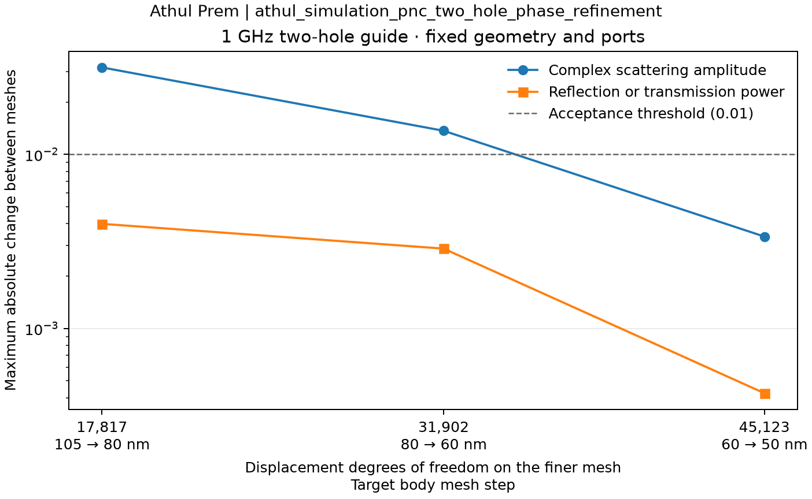

# Phononic Nanobeam Design Lab

**Research owner: Athul Prem | `_AP_pnc`**

A configurable three-dimensional anisotropic elastic-wave simulator for high-purity germanium nanobeams. It provides 3D beam eigenmodes, periodic guided-wave dispersion, power-normalized matched-port scattering, CSV-defined circular through-holes and offline interactive reports. The solver runs on a CPU using Python, scikit-fem, SciPy and Gmsh. All project documentation, software text and generated reports use English.

## Quick start

Use Python 3.12 in a dedicated virtual environment. Run these commands from the project directory.

```powershell
python -m venv .venv
.\.venv\Scripts\python.exe -m pip install -r requirements_3d_AP_pnc.txt
.\.venv\Scripts\python.exe simulate_AP_pnc.py --open
```

Once the environment is set up, you can double-click `Launch_AP_pnc.cmd`. The default case is a homogeneous 3D cantilever benchmark measuring 2000 nm long, 1000 nm wide and 200 nm thick. Its left end is clamped and the other surfaces are traction free.

For the optional English desktop workbench, install its separate interface dependencies and launch it:

```powershell
.\.venv\Scripts\python.exe -m pip install -r requirements_ui_AP_pnc.txt
.\.venv\Scripts\python.exe workbench_AP_pnc.py
```

On Windows, `Launch_Workbench_AP_pnc.cmd` opens the same interface. Choose a preset or load a JSON configuration, edit the displayed parameters, then use **Check mesh** or **Run**. The interface uses the existing solver and its saved meshes/results. Material properties, crystal orientation and hole placement retain the loaded configuration's provenance. Hole coordinates do not scale or recenter when beam dimensions change. **Open report** becomes available after a completed solve. The core command-line workflow does not require the Qt interface dependencies.

The workbench runs one background job at a time. **Stop** ends its process tree and preserves submitted inputs, logs and any partial scientific output. A mesh-ready message means only that meshing completed; a computed result remains unverified until the relevant convergence checks are established. The initial interface edits the main numerical inputs and retains the loaded analysis and boundary selection; broader material and geometry editors are future work. Windows offscreen interaction tests and a readable preview were checked. Native interaction on other operating systems has not been tested.

Use **Open saved run** to reopen a completed result folder, including runs made from the command line. For scattering, **Compare saved run** selects a reference folder and compares it with the currently loaded result without solving again. The English report lists per-channel reflection/transmission powers, complex-coefficient changes and same-channel transmission phases. It matches signed-power modes by their field overlap before comparing amplitudes. Both input power-balance checks and the two 0.01 change criteria must pass for a mesh-pair acceptance; identical stored discretizations are labeled repeatability checks. A passing pair does not establish continuum convergence or certify other frequencies.

The comparison is also available without Qt:

```powershell
.\.venv\Scripts\python.exe tools/compare_scattering_AP_pnc.py --reference path/to/coarser-run --candidate path/to/finer-run
```

Select two completed scattering run directories with the same physical geometry, material, frequency, incident end and numerical-core version. The tool verifies saved file checksums and retains the original reference-plane phase. It writes a separate HTML report, CSV and provenance summary under `results/runs/comparisons/`; source runs are preserved. Changed channel counts or unresolved mode matching require a separate analysis. Exit code 0 means the comparison completed, including a comparison whose scientific criteria failed; the report and JSON state those outcomes separately.

Edit [straight_beam_AP_pnc.json](configs/straight_beam_AP_pnc.json) to configure a run, or use the following command-line options.

```powershell
# Change the physical thickness while keeping the in-plane geometry fixed.
.\.venv\Scripts\python.exe simulate_AP_pnc.py --thickness-nm 100 --open

# Model an infinite uniform guide with one Bloch-periodic cell and free sidewalls.
.\.venv\Scripts\python.exe simulate_AP_pnc.py --analysis bloch --cells 4 3 2 --k-points 9 --open

# Include the six rigid-body zero modes when requesting modes of a free beam.
.\.venv\Scripts\python.exe simulate_AP_pnc.py --boundary free --modes 10

# Drive each propagating channel of a uniform guide at 0.3 GHz.
.\.venv\Scripts\python.exe simulate_AP_pnc.py --config configs/straight_scattering_AP_pnc.json --open

# Select the opposite incident end and a different frequency.
.\.venv\Scripts\python.exe simulate_AP_pnc.py --config configs/straight_scattering_AP_pnc.json --incident-side right --frequency-ghz 0.5

# Run a small two-hole device, then its no-hole control with the same mesh settings.
.\.venv\Scripts\python.exe simulate_AP_pnc.py --config configs/perforated_beam_AP_pnc.json --open
.\.venv\Scripts\python.exe simulate_AP_pnc.py --config configs/perforated_beam_AP_pnc.json --uniform --open

# Reproduce the finer two-hole reference settings (about 2 GiB in the measured case).
.\.venv\Scripts\python.exe simulate_AP_pnc.py --config configs/perforated_phase_reference_AP_pnc.json --open

# Run the original 26-hole geometry as a single-frequency pilot.
.\.venv\Scripts\python.exe simulate_AP_pnc.py --config configs/historical_26hole_AP_pnc.json --open

# Inspect and save a finer device mesh before mechanical assembly.
.\.venv\Scripts\python.exe simulate_AP_pnc.py --config configs/historical_26hole_AP_pnc.json --mesh-size-nm 160 --mesh-only
```

Each case writes an interactive `report_AP_pnc.html`, a mode CSV, the resolved configuration, a summary with source and environment details, an NPZ with the full quadratic-element degree-of-freedom mapping, and a VTU for ParaView under `results/runs/`. The VTU samples normalized mode shapes at vertices. Physical displacement amplitudes would require a specified excitation. Bloch rows are sorted by frequency independently at each wavenumber. Branch tracking across wavenumbers remains pending.

Scattering runs instead write `scattering_AP_pnc.csv` with per-input-channel power ratios, `scattering_channels_AP_pnc.csv` with complex amplitudes and power in each propagating output channel, and `port_modes_AP_pnc.csv` with the complete discrete port root inventory. Their NPZ retains full driven responses, propagating and evanescent amplitudes, port fields and mappings. Displacements are responses per square root of incident watt; 1 W is a mathematical normalization. The report supports channel selection and phase adjustment. A successful matched-guide power check does not by itself establish phase accuracy or mesh convergence.

The runner checks completed outputs before reusing results with the same configuration, source and numerical environment. It preserves failed or interrupted attempts and retries in new directories. Large frequency sweeps still require per-frequency checkpoint and restart support.

`--mesh-only` saves the exact tagged mesh under `results/runs/_meshes/` and reports body and end-face degrees of freedom without assembling or solving. It can report a body mesh above the current `max_dofs`; the port-generation cap still applies. The measured 160 nm full-device mesh has 82056 body DOFs, above its preset cap of 60000. To run it after choosing a resource budget, omit `--mesh-only` and add `--max-dofs 90000` to the same command. The runner checks and reuses that saved mesh. Changing frequency, material or the body budget does not require a new mesh; changing geometry, meshing settings or the mesh implementation does. A mesh-ready status does not mean a simulation or convergence check has passed. The measured 1888 MiB full-device run is an example, not a memory guarantee.

For holes, `geometry.pattern.csv` is relative to the repository root and `x_offset_nm` explicitly places the CSV origin in the beam's 0-to-length coordinates. The original array uses an 8325 nm shift in a 16650 nm-long beam, leaving 1500 nm beyond each outer hole rim. Results retain the raw CSV checksum, placed SI coordinates, clearances and geometry diagnostics. CSV content changes invalidate cached results. Gmsh settings independently control body size, port size, and hole-circle segments (multiples of four). The affine mesh uses regular inscribed prisms to approximate exact CAD circles. `max_dofs` limits finite-element assembly after mesh generation; it does not bound Gmsh's mesh-generation memory. The 26-hole pilot explicitly allows up to 60000 DOFs; the finer two-hole reference allows 55000. Other examples keep smaller caps.

The optional `layered` mesh separates in-plane resolution from thickness subdivision. It meshes the perforated footprint once, copies it onto equally spaced thickness planes and splits each triangular prism into conforming tetrahedra. The model retains three-dimensional elasticity and all three displacement components. `mesh_size_nm` controls the x-y footprint, `thickness_layers` controls the number of z intervals, and `port_size_nm` controls the width subdivision of each end. Changing thickness layers also changes the port's thickness resolution; its SAFE wavenumbers therefore need a separate check. Changing in-plane size at fixed layer count preserves the port triangles and fixed circle polygon.

Select **Two-hole beam · layered mesh** in the workbench, or use:

```powershell
# Inspect the two-hole layered mesh: 105 nm in-plane size and two thickness layers.
.\.venv\Scripts\python.exe simulate_AP_pnc.py --config configs/perforated_layered_AP_pnc.json --mesh-only

# Refine only the footprint; physical thickness and layer count stay fixed.
.\.venv\Scripts\python.exe simulate_AP_pnc.py --config configs/perforated_layered_AP_pnc.json --mesh-size-nm 80 --mesh-only

# Refine thickness subdivision while preserving the same footprint.
.\.venv\Scripts\python.exe simulate_AP_pnc.py --config configs/perforated_layered_AP_pnc.json --thickness-layers 3 --mesh-only
```

Omit `--mesh-only` to solve after selecting a resource budget. The default layered preset has 13485 body DOFs and 135 DOFs per port in the measured mesh. The new backend is an additional resolution control; it does not certify full-device phase accuracy. Saved results remain available through **Open saved run** and the comparator. This workflow update changes the cache identities of future requests; it does not alter or repeat existing saved results.

For the refined two-hole case described below, select **Two-hole refined layers · scattering**, or use `--config configs/perforated_layered_reference_AP_pnc.json`. It uses an 80 nm in-plane target, four thickness layers and a 100 nm port-width target. The measured case has 31887 body DOFs and 351 per port, with about 1255 MiB peak process-tree memory. Its settings and checks apply to the stated two-hole case at 1 GHz; arbitrary geometry/frequency changes require new checks.

## Verification and capabilities

The current Windows/Python 3.12 suite ran 79 tests: 78 passed and one was skipped because the process lacked permission to create a symbolic link. The checks cover tensor rotation, uniform strain, consistent mass, rigid-body subspaces, independent dense and sparse solutions, Bloch phase and the long-wavelength rod limit. Port checks cover trace mapping, directional energy flux, the dispersion-derivative identity, exact symmetry degeneracy, an independent 3D Bloch comparison, and explicit rejection of unresolved cutoffs. Scattering checks exercise both incidence directions, independent boundary flux, and reconstruction from exported fields. Geometry/workflow checks cover identical Gmsh end traces, analytic polygon volumes, independent curvature refinement, CSV provenance, cache invalidation, preflight budgets and exact tagged-mesh reuse. Saved-run checks cover unequal P1/P2 port traces, mode ordering and phase invariance, repeatability labeling, input power-check failures, reopening results and the desktop comparison workflow.

The [three-mesh convergence record](verification/straight_beam_validation_AP_pnc.json) covers the first four cantilever modes of the default geometry with 1755, 5187 and 11475 degrees of freedom. The maximum frequency change between the two finest meshes was about 0.468%, and the minimum mass-weighted mode overlap was about 0.999992. Independent fixed-property assemblies and solves labeled 20 mK and 4 K yielded identical matrices and frequencies. Convergence for other geometries, thicknesses and frequency bands requires its own checks.

The [straight-guide scattering acceptance](verification/straight_scattering_acceptance_AP_pnc.json) covers nominal Ge at 1 GHz, a 600 × 200 nm cross-section, lengths of 1 and 1.5 µm, and four incident channels from each end. Complex transmission errors against a common finer SAFE reference were at most 0.00454 and 0.00683, below the 0.01 criterion. The final section refinement changed accumulated phase by at most 0.00534 rad over 1.5 µm. The 14553-DOF long-guide case had maximum reflection about 1.20 × 10⁻⁷ and direct power imbalance below 5.2 × 10⁻¹⁵. These checks establish this numerical benchmark, with a finite-element reference rather than an exact continuum error bound. Earlier coarse-mesh failures and refinement evidence remain saved and linked by checksums. The 0.3 GHz quick-start case has its own power check and does not inherit this mesh acceptance.

The [two-hole power study](verification/two_hole_scattering_validation_AP_pnc.json) uses a 1800 × 600 × 200 nm beam, two 250 nm holes 550 nm apart, and 1 GHz excitation. The largest T/R change between the final two main body meshes was 0.00366. Curvature, lead-length and port refinements changed T/R by at most 0.00054, 0.00153 and 0.00135. Power budgets and reciprocity passed. An additional 105 to 80 nm body refinement changed a complex scattering coefficient by 0.03162, exceeding the 0.01 criterion. That original evidence retains all 64 directional channel records and the failed gate.

The subsequent [two-hole phase refinement](verification/two_hole_phase_refinement_AP_pnc.json) holds the 48-segment holes and ports fixed and extends the body meshes to 60 and 50 nm. Complex changes decrease from 0.03162 to 0.01367 to 0.00337; the final pair's maximum T/R change is 0.000425. Both final changes meet the unchanged 0.01 criterion. The 45123-DOF finest solve took 58.75 s; its monitored process tree peaked at about 2064 MiB. This is a bounded mesh-pair acceptance for this two-hole case at 1 GHz, not a rigorous continuum error bound or validation of other frequencies, resonances or the full device. The [offline checker](tools/check_phase_refinement_AP_pnc.py) verifies the saved matrices, power budgets, reciprocity, source hashes and comparisons without new solves.



The [original 26-hole pilot](verification/historical_26hole_pilot_AP_pnc.json) ran at 1 GHz with 56220 DOFs and five propagating incident channels in the discretized lead. Transmission ranged from 0.96006 to 0.99974; direct power imbalance was below 2.3 × 10⁻¹³. The run used 14.76 s and approximately 1089 MiB sampled process memory. This is a single-mesh, single-frequency execution result, with no device-convergence or band-gap claim. The 32-segment holes have a 0.6413% removed-volume error relative to circular cylinders.

A subsequent [26-hole mesh comparison](verification/historical_26hole_refinement_AP_pnc.json) reused that pilot and solved one finer, 82056-DOF mesh at the same 1 GHz frequency. The five left-incident channels changed T/R by up to 0.01136 and complex scattering coefficients by up to 0.42286; both exceed 0.01. The largest same-channel transmission phase change was 0.429 rad despite matching port modes and wavenumbers. The solve completed in 22.09 s with 1888 MiB monitored process-tree memory. Body refinement also changed hole-wall thickness partitioning from one to two layers, so this comparison does not isolate one source of discretization error. Full-device convergence remains failed, and the power balance alone cannot validate its phase or spectrum.

The [device and port follow-up](verification/device_convergence_followup_AP_pnc.json) adds a 130 nm body mesh with 96903 DOFs, the same 32-segment holes and 99-DOF ports, and the same two hole-wall thickness layers as the 160 nm mesh. Its power change is 0.002339 (passes 0.01), while its complex-coefficient change is 0.137744 (fails 0.01). It took 31.41 s end to end with 2229 MiB peak process-tree memory. Independent SAFE-only port refinements from 99 to 195 to 315 trace DOFs retain five propagating channels each way. The last pair's wavenumber change corresponds to 0.05638 rad over the combined 3 micrometres of uniform leads. This is a phase-sensitivity indicator, not a bound on patterned-device scattering error or a phase correction to subtract. Port accuracy remains unresolved. The [offline follow-up checker](tools/check_device_followup_AP_pnc.py) reproduces these comparisons from compact saved evidence without new solves.

The [directional-resolution diagnostic](verification/wave_resolution_diagnostic_AP_pnc.json) uses four small structured 1.2 micrometre uniform guides at 1 GHz, with a 1000 by 200 nm section. At fixed SAFE ports, reducing axial spacing from 200 to 100 nm reduces maximum phase error relative to `exp(i*k*L)` from 0.07201 to 0.02451 rad with one thickness layer, and from 0.04531 to 0.01234 rad with two layers. The largest case has 4125 body DOFs and took 1.18 s with 163 MiB sampled process memory. All power budgets close below 7.4e-15, while the finest phase/complex errors still exceed 0.01. Thickness refinement also changes the discrete reference phase by up to 0.05782 rad over the guide. These controls isolate useful refinement directions; their errors are not corrections to apply to a perforated device. The integrated test suite verifies the portable matrices and channel CSV without rerunning these cases.

The [layered-mesh pilot](verification/layered_mesh_acceptance_AP_pnc.json) retains three two-hole meshes at 105/80/60 nm in-plane targets, two thickness layers, 48-segment holes and 135-DOF ports. Successive power changes are 0.001525/0.001113 and complex changes 0.010391/0.006834: only the final pair passes both 0.01 change criteria. The finest 26025-DOF run took 10.14 s end to end and about 746 MiB peak process-tree memory. Independent uniform controls at 105/60 nm differ from their fixed discrete SAFE transmission reference by 0.019773/0.028144 in complex amplitude; both fail 0.01. The interior transverse mesh also changes with in-plane refinement, while the end trace stays coarse. That initial study established in-plane sensitivity only; thickness and port resolution were still unresolved. All original failures are retained.

An offline comparison with the previously saved unstructured 50 nm two-hole reference gives complex differences 0.020265/0.013431 for the two-layer 80/60 nm cases. Both still exceed 0.01, despite passing power-change checks. That reference is itself a bounded numerical benchmark, not an exact continuum solution. These original failures remain saved.

The subsequent [thickness and port follow-up](verification/layered_resolution_followup_AP_pnc.json) holds the 80 nm in-plane target and 48-segment holes fixed. Thickness changes preserve the exact footprint; port-width changes require a new conforming footprint, so the latter measure combined port/remesh sensitivity.

| Comparison at 1 GHz | Maximum power change | Maximum complex change | Both below 0.01 |
| --- | ---: | ---: | --- |
| Two to three layers, 150 nm port width target | 0.001082 | 0.014503 | No |
| Three to four layers, same width target | 0.000349 | 0.004367 | Yes |
| 150 to 100 nm port width target, four layers | 0.000250 | 0.000708 | Yes |
| Refined four-layer case versus saved unstructured h50 reference | 0.000662 | 0.001857 | Yes |

The selected four-layer/100 nm-port case took 19.06 s end to end. These are bounded checks at one geometry and frequency, not a continuum error bound, band-gap result or validation of the full 26-hole device.

The separate [SAFE-only section study](verification/layered_port_resolution_AP_pnc.json) reuses the original 4-by-2 width/thickness section and adds six small refinements. A common 8-by-4 section has 459 trace DOFs and four propagating modes each way. Its final width and thickness comparisons give phase indicators 0.004447/0.009469 rad over 1.8 micrometres. Comparing the already saved uniform h105/h60 runs against this same finite reference gives complex errors 0.015807/0.007435: the finer run passes 0.01. No simulation was repeated. Their earlier native coarse-port discrepancies remain valid diagnostics but cannot rank accuracy against the continuum; the common-reference comparison resolves that misleading trend.

Use the offline tool with a completed uniform scattering run:

```powershell
.\.venv\Scripts\python.exe tools/compare_uniform_reference_AP_pnc.py --run path/to/completed-uniform-run
```

It uses the checked-in 8-by-4 reference by default, verifies matching section/material/frequency, and writes JSON and channel CSV without solving. The supplied reference covers the 600 by 200 nm section at 1 GHz; a different section needs its own reference. It reports response and reference-refinement checks separately, retains phase at the original end planes, and rejects patterned devices. No uniform phase is subtracted from a device scattering matrix. Exit code 0 means the comparison completed, including scientific checks that failed.

| Capability | Status |
| --- | --- |
| Three-dimensional homogeneous beam with P1/P2 vector tetrahedra | Available |
| Nominal cubic elasticity with crystal-to-lab rotation | Available with fixed properties. Low-temperature specimen calibration remains pending. |
| Finite-beam eigenmodes with free, one-end-clamped or two-end-clamped boundaries | Available |
| Bloch dispersion for guides with free sidewalls | Available for a finite branch sample. Channel completeness remains unverified. |
| 26-hole inputs and clearance checks | Verified with the original `position_nm` and example `x_nm` column formats |
| Gmsh three-dimensional through-holes | Configurable from CSV; fixed hole faceting and matching end traces. Two-hole checks and one full 26-hole pilot completed. |
| Port power transmission, reflection and mode conversion | Available for uniform and perforated beams. Bounded two-hole power/complex-response checks pass at 1 GHz; full-device mesh convergence remains unresolved. |
| Temperature-dependent properties, physical loss, bent beams and rings | Planned |
| GPU solver | CPU measurements will inform whether GPU development is warranted. |

The unstressed linear-elastic model requires additional physics and validation to address intrinsic loss, radiative quality factor, experimental performance or single-phonon quantum states. A successful solve establishes execution. Mesh convergence and experimental validation require separate evidence. Offline report script interactions were checked. Browser file-access rules prevented screenshot verification.

## Run verification

```powershell
$env:OPENBLAS_NUM_THREADS='1'
$env:OMP_NUM_THREADS='1'
.\.venv\Scripts\python.exe -B -m unittest discover -s tests -p 'test*_AP_pnc.py' -v
.\.venv\Scripts\python.exe -B tools/validate_3d_AP_pnc.py
.\.venv\Scripts\python.exe -B tools/validate_scattering_AP_pnc.py --acceptance --output-dir results/runs/scattering-verification
.\.venv\Scripts\python.exe -B tools/validate_perforated_AP_pnc.py
.\.venv\Scripts\python.exe -B tools/check_phase_refinement_AP_pnc.py
.\.venv\Scripts\python.exe -B tools/check_device_refinement_AP_pnc.py
.\.venv\Scripts\python.exe -B tools/check_device_followup_AP_pnc.py
```

The validation tool uses three independent mesh solves, mass-weighted mode matching and a fixed-property temperature control. It reports failed checks with a nonzero exit code and retains the computed values and original material inputs. The `--quick` option exercises the workflow on coarser meshes, which may fail the 0.5% frequency-change threshold.

The scattering acceptance command checks the saved reference/source hashes, reuses the unchanged short-guide evidence, and computes a new long-guide solution and finer SAFE reference. The largest local case took 19.64 s and reached approximately 605 MiB sampled process memory. Use a fresh output directory to retain results from each independent run. The baseline and `--refine` modes reproduce the earlier coarse stages; their expected phase failures are retained as evidence.

The perforated validator defaults to the empty guide and three main two-hole meshes. It stores reusable per-case mesh and solve checkpoints under `results/perforated_validation/`. Use repeated `--case` options to select controls such as `curvature_fine`, `long_leads`, `port_fine` and `body_phase_fine`; include both members of a comparison. The saved all-case study includes a failed phase gate and returns exit code 2. `--mesh-only --case original_26` measures the original mesh without attempting the validator's 30000-DOF-limited solve. The separate public 26-hole configuration has its own explicit 60000-DOF pilot budget.

The device-refinement checker verifies preserved data without solving. Its default exit code 0 means the evidence is intact, and it explicitly prints the failed scientific acceptance. Add `--require-converged` to return exit code 2 for the current failed 26-hole mesh pair. CI checks evidence integrity; it does not declare that device converged.

## Development plan and references

- [Implementation plan and reuse decisions](docs/IMPLEMENTATION_PLAN_AP_pnc.md)
- [Current development handoff](docs/AI_HANDOFF_AP_pnc.md)
- [Physics specification](docs/PHYSICS_SPECIFICATION_AP_pnc.md)
- [Long-term research work packages](docs/NEXT_STEPS_AP_pnc.md)
- [Material references and validity limits](docs/REFERENCES_AP_pnc.md)

The next numerical work transfers the independently checked thickness/port strategy to the full device, starting with its own 1000 by 200 nm section and a resource preflight. The two-hole 1 GHz checks do not transfer automatically to the longer, wider structure. Reuse existing matrices and common-reference diagnostics before further solves; hole faceting and frequency coverage remain separate checks. Temperature-dependent properties, bends and larger sweeps follow when the corresponding inputs and checks are established. QTCAD served as a workflow reference. The phonon solver uses the libraries listed above.

## Historical two-dimensional evidence

The historical files are retained in `archive/`, `results/archive_*`, `figures/archive_*` and `provenance/`. The Git download is about 32 MB, and the active solver runs independently of the archive.

All 199 files from the original upload are preserved byte for byte. The older inventory has 223 unresolved entries, including 222 missing entries and one dependency file whose content differs from the expected bytes. The missing files prevent exact reproduction of the latest 2D workflow. The new 3D solver has independent provenance. The historical gap near 3 GHz applies to a 2D in-plane model, and approximately −42.25 dB refers to a probe displacement ratio. Both require independent 3D power calculations before drawing conclusions about transmission. [Evidence and missing files](docs/EVIDENCE_AND_RECOVERY_AP_pnc.md)

Use these legacy entry points to inspect the saved evidence.

```powershell
.\.venv\Scripts\python.exe tools/audit_repository_AP_pnc.py
.\.venv\Scripts\python.exe verify_AP_pnc.py --fields --safety
.\.venv\Scripts\python.exe run_AP_pnc.py --name hpge_reference --dry-run
```

New figures and project files retain the attribution `Athul Prem | _AP_pnc`. Final research-report requirements are in `reports/`. External delivery requires current user authorization.
