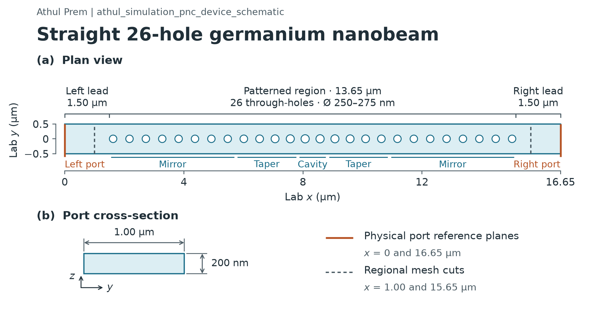

# Phononic Nanobeam Design Lab

**Research owner: Athul Prem | `_AP_pnc`**

How does a row of 26 tapered through-holes change the elastic waves that travel through a germanium nanobeam? The project uses a configurable 3D finite-element solver to compare how much incident power the device transmits, reflects or converts between guided modes.

[](figures/README.md#figure-1--device-geometry)

The beam is 16.65 µm long and 1.00 µm wide. The hole pattern occupies 13.65 µm between two 1.50 µm leads. The studies use nominal cubic germanium and evaluate scattering at the original physical end planes. [Geometry and model inputs](data/README.md)

The solver and desktop workbench are available. Saved device solutions pass the original discrete equations and recorded power checks. The finite 0.1 GHz controls pass their complex-response threshold. The 887.5 MHz weak conversion and 1 GHz complex response remain sensitive to the mesh. Full-device spatial and frequency convergence remain unresolved. [Research status and evidence](docs/RESEARCH_STATUS_AP_pnc.md)

| To do this | Start here |
| --- | --- |
| See how the device responds | [Figure gallery](figures/README.md) and [saved results](#open-saved-results) |
| Run or configure a small study | [Start the simulator](#start-the-simulator) and [configuration guide](configs/README.md) |
| Understand the model or continue development | [Research documentation](docs/README.md) |

## Open saved results

From the repository root, the offline browser works with Python's standard library:

```powershell
python -B tools/browse_device_results_AP_pnc.py --open
```

The portable dataset contains the 200 nm device on the archived global h80/z6 mesh at 0.1, 0.8875 and 1 GHz. It includes 14 incident-drive rows, 132 complex coefficients and the exact inputs. Roots are frequency-local. The regional 1 GHz lead and thickness-layer controls use a separate mesh family. [Dataset, exports and archive availability](data/README.md) · [1 GHz comparison plots](figures/README.md#figure-2--1-ghz-regional-transmission-sensitivity)

The same reader shows the nine saved points of the 100 nm device and the finer regional controls. Compare all three mesh traces for drives 3 and 5, then select a mesh, frequency and drive to inspect native coefficients, download the exact configuration or export the full grid. [Three-mesh frequency comparison](figures/README.md#figure-4--thin-device-frequency-response-on-three-meshes) [Thin-device dataset](data/README.md#thin-device-research-dataset)

## Start the simulator

With Python 3.12, run the small default cantilever from the repository root:

```powershell
python -m venv .venv
.\.venv\Scripts\python.exe -m pip install -r requirements_3d_AP_pnc.txt
.\.venv\Scripts\python.exe simulate_AP_pnc.py --open
```

For the optional desktop workbench, install the PySide6 requirements and launch it:

```powershell
.\.venv\Scripts\python.exe -m pip install -r requirements_ui_AP_pnc.txt
.\.venv\Scripts\python.exe workbench_AP_pnc.py
```

Use **Check mesh** before running a modified study. **Browse device results** reads the saved 26-hole dataset without starting a worker. [Presets and mesh controls](configs/README.md) · [Bounded frequency maps and recovery](tools/README.md) · [Environment](docs/ENVIRONMENT_AP_pnc.md)
