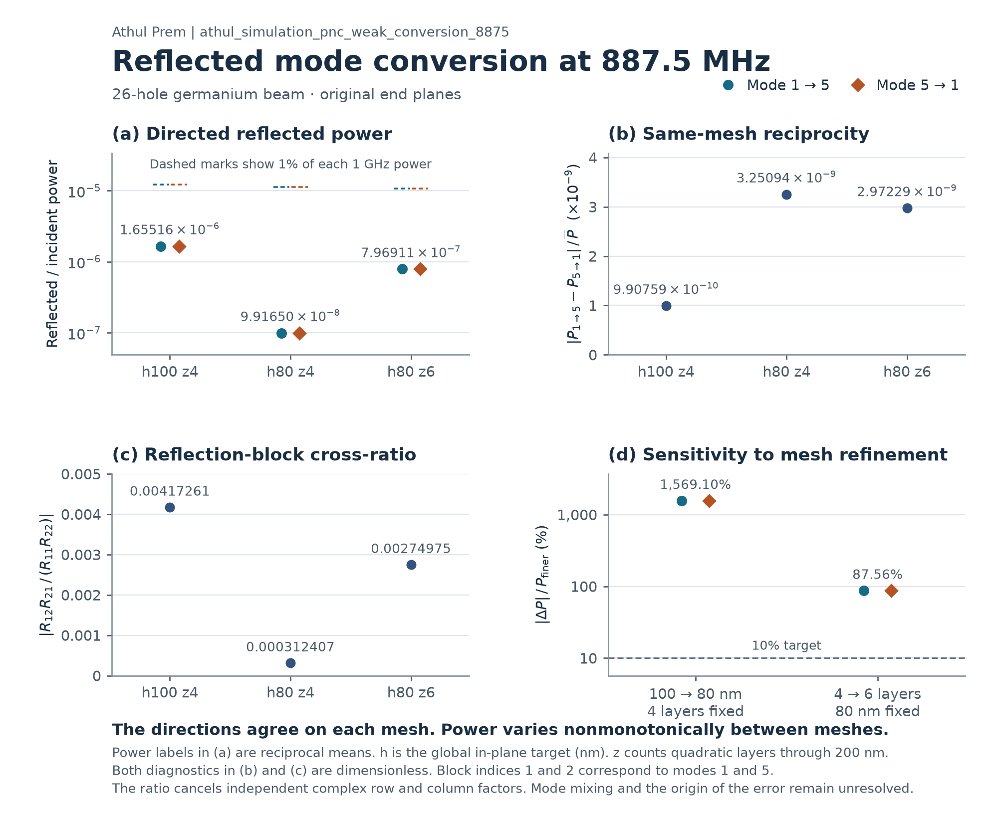
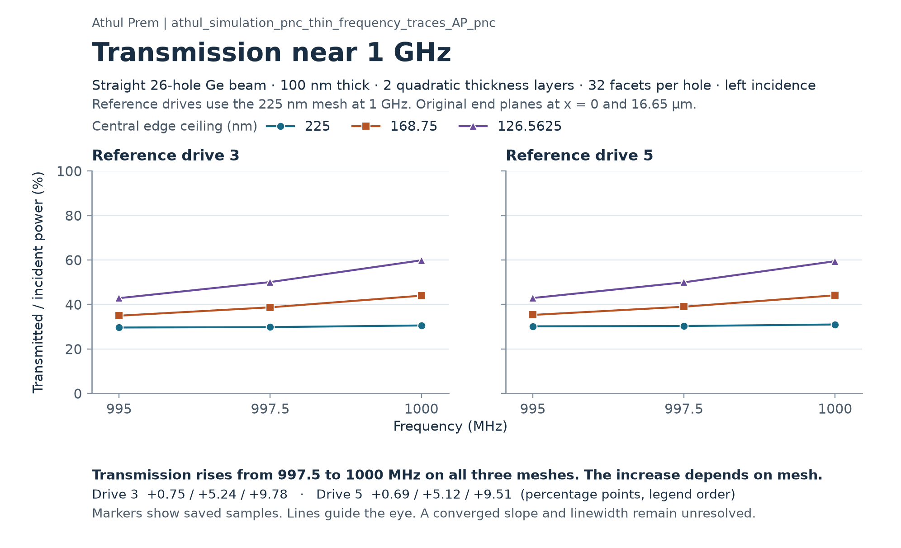

# Straight 26-hole device figures

Author: **Athul Prem** | Project/file tag: **`_AP_pnc`**

[Project home](../README.md) · [Saved inputs and results](../data/README.md) · [Research status](../docs/RESEARCH_STATUS_AP_pnc.md) · [887.5 MHz reciprocity comparison](#figure-3--8875-mhz-reflected-mode-conversion)

## Figure 1 · Device geometry

The dimensions and labeled hole groups show where the device is patterned and where incoming and outgoing waves are measured.


The original port planes are at the beam ends, 16.65 µm apart. The first and last hole rims bound a 13.65 µm patterned span. Each unperforated lead is 1.50 µm long. The regional mesher cuts at 1.00 and 15.65 µm in solid material. Those cuts mark mesh interfaces. The archived global meshes in Figure 3 use whole-device in-plane targets.

[Vector PDF](device_AP_pnc/athul_simulation_pnc_device_schematic_AP_pnc.pdf) · [Plotted hole positions and diameters (CSV)](device_AP_pnc/device_geometry_AP_pnc.csv) · [Schematic script](../tools/plot_device_schematic_AP_pnc.py) · [Input hole table](../data/geometry/hole_geometry_derived_AP_pnc.csv) · [Saved geometry](../data/saved_device_AP_pnc/h80_z6_1/summary_AP_pnc.json) · [Regional configuration](../configs/historical_26hole_regional_AP_pnc.json)

## Figure 2 · 1 GHz regional transmission sensitivity

The two controls compare changes in total power and complex transmission when refining the leads or changing the number of thickness layers.


The regional controls use a 200 nm thick beam, nominal cubic germanium with crystal axes aligned to the laboratory axes and the original end planes. On each comparison the figure shows the matched pair with the largest complex-amplitude change. Refining the leads from 200 to 150 nm at fixed central resolution shifts the 5→5 transmission phase by +2.432° and its magnitude by −0.00007124. Increasing the quadratic layer count from one to two through the same physical thickness also changes the compatible port section. The limiting 1→1 transmission phase shifts by +49.764° and its magnitude by +0.001130.

Both comparisons pass the 0.01 absolute total-power increment limit. The corresponding maximum aligned complex increments are 0.04239 and 0.83598, both above the 0.01 limit. In the lead control, drive 1 reflection rises from 1.1893% to 1.4007%, or +0.2114 percentage points and +17.77% relative. Read these numbers as finite regional-mesh sensitivities.

[Vector PDF](device_AP_pnc/athul_simulation_pnc_transmission_refinement_1GHz_AP_pnc.pdf) · [Plotted coefficients and power (CSV)](device_AP_pnc/transmission_refinement_1GHz_AP_pnc.csv) · [Plot script](../tools/plot_transmission_refinement_AP_pnc.py) · [Lead control](../verification/regional_lead_1GHz_AP_pnc.json) · [Thickness-layer control](../verification/regional_thickness_1GHz_AP_pnc.json)

## Figure 3 · 887.5 MHz reflected mode conversion

The three meshes test whether a reciprocal pair remains consistent within each saved discretization and how its magnitude changes between discretizations.



These 200 nm thick global-mesh runs use the same nominal material and original end planes. Here `h` is the in-plane target in nm and `z` counts quadratic thickness layers. The two directions use matched 887.5 MHz modes 1 and 5, with native roots recorded in the CSV. The h100/z4 and h80/z4 meshes share an identical saved port basis. The h80/z4 and h80/z6 comparison uses signed mode matches. The two refinements change different numerical axes.

| Global mesh | Mean reciprocal power as fraction of incident power |
| --- | ---: |
| h100/z4 | 1.6552 × 10⁻⁶ |
| h80/z4 | 9.9165 × 10⁻⁸ |
| h80/z6 | 7.9691 × 10⁻⁷ |

The relative mismatch of the two reciprocal powers is at most 3.251 × 10⁻⁹ on a single mesh, calculated as their absolute difference divided by their mean. That mismatch is a consistency observation. Relative to the finer power in each mesh pair, the changes are 1569.1% in-plane and 87.56% through thickness. Both exceed the 10% sensitivity target. Each mesh meets the separate suppression target against its own 1 GHz result, with a power ratio at most 0.01.

For the matched two-mode reflection block, row `i` is the outgoing mode and column `j` the incident mode. Block indices 1 and 2 correspond to section modes 1 and 5. The complex cross-ratio

$$
\chi = \frac{R_{12}R_{21}}{R_{11}R_{22}}
$$

cancels independent nonzero complex scalings of each row and column when the diagonal entries are nonzero. The CSV gives the four original complex entries, the complex ratio, its magnitude and principal phase. Its magnitude changes nonmonotonically with the two refinements, which excludes independent rescaling and rephasing alone for these matched blocks. Mode mixing, the error location, full-matrix reciprocity and the continuum conversion magnitude remain outside this diagnostic. [Observable-specific claim limits](../docs/RESEARCH_STATUS_AP_pnc.md)

[Vector PDF](device_AP_pnc/athul_simulation_pnc_weak_conversion_8875_AP_pnc.pdf) · [Directed powers and denominators (CSV)](device_AP_pnc/weak_conversion_8875_AP_pnc.csv) · [Native complex blocks and ratio (CSV)](device_AP_pnc/weak_conversion_diagnostics_8875_AP_pnc.csv) · [Plot script](../tools/plot_weak_conversion_AP_pnc.py) · [Ratio calculation](../tools/weak_conversion_diagnostics_AP_pnc.py)

[In-plane input record](../data/saved_device_AP_pnc/controls/frequency_inplane_8875_AP_pnc.json) · [Thickness input record](../data/saved_device_AP_pnc/controls/frequency_thickness_8875_AP_pnc.json) · [Saved endpoint relation](../verification/device_frequency_8875_AP_pnc.json)

## Figure 4 · Thin-device frequency response on three meshes



Both panels compare the same three saved frequencies on central edge ceilings of 225, 168.75 and 126.5625 nm, with a shared 0–100% transmitted-incident-power scale. The physical beam thickness is 100 nm, with two quadratic thickness layers, 32 fixed facets per hole rim and left incidence. Reference-drive labels follow the 225 nm mesh at 1000 MHz through the recorded signed mode matches; native roots remain sample-local. Original reference planes remain x=0 and 16.65 µm.

| Central edge ceiling (nm) | Drive 3 ΔT (percentage points) | Drive 5 ΔT (percentage points) |
| --- | ---: | ---: |
| 225 | +0.75 | +0.69 |
| 168.75 | +5.24 | +5.12 |
| 126.5625 | +9.78 | +9.51 |

Here ΔT = 100 × [T(1000 MHz) − T(997.5 MHz)], with T a fraction of incident power. These are absolute percentage-point changes, not relative percent changes. Their positive direction agrees on the three meshes, while the magnitude remains mesh-sensitive. Connecting segments are visual guides between the three saved samples. No converged frequency slope or linewidth is established by the finest trace or by agreement of the signs. This directly implements [Athul's saved-data comparison request](https://github.com/premathul/Phononic-Nanobeam-Design-Lab/pull/58#issuecomment-7046690925).

[Vector PDF](device_AP_pnc/athul_simulation_pnc_thin_frequency_traces_AP_pnc.pdf) · [All 18 plotted samples and native identities (CSV)](device_AP_pnc/thin_frequency_traces_AP_pnc.csv) · [Plot script](../tools/plot_thin_frequency_traces_AP_pnc.py) · [Pinned nine-point record](../verification/thin_mesh_frequency_AP_pnc.json) · [Offline reader](../tools/browse_device_results_AP_pnc.py)

## Reproduce the figures

Run from the repository root with [the plotting environment](../requirements_3d_AP_pnc.txt). The generator writes four vector PDFs, four PNG previews and five CSVs under `figures/device_AP_pnc/`. Use `--output-dir PATH` for a separate copy.

```powershell
.\.venv\Scripts\python.exe tools/plot_saved_device_figures_AP_pnc.py --output-dir results/reproduction/figures_AP_pnc
```

The plots use tracked inputs and require Matplotlib. The complex-ratio calculation uses the standard library. The portable controls are checked against the [dataset manifest](../configs/saved_device_dataset_AP_pnc.json). Native coefficient paths and SHA-256 hashes in the CSVs identify original archive artifacts. Figure reproduction requires only the tracked inputs and starts no simulation.

## Historical figures and small benchmarks

[Earlier nominal-Ge figures](archive_latest) and [smoke figures](archive_smoke) preserve the original PDFs and pixels from the 2D lineage recorded in the November 2026 handoff. Treat historical labels such as 4 K as metadata for the nominal fixed-property model used in those runs. [Historical evidence and model scope](../docs/EVIDENCE_AND_RECOVERY_AP_pnc.md)

[Two-hole phase benchmark plot](verification/two_hole_phase_refinement_AP_pnc.png) accompanies the [small scattering benchmarks](../verification/README.md#small-benchmarks-and-workflow-checks). For new derivatives and exports, follow [attribution and provenance rules](../docs/AUTHORSHIP_AND_NAMING_AP_pnc.md).
