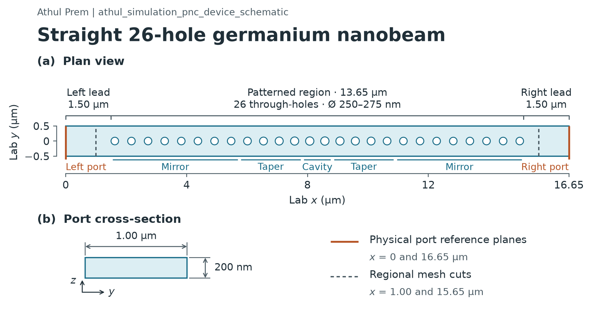
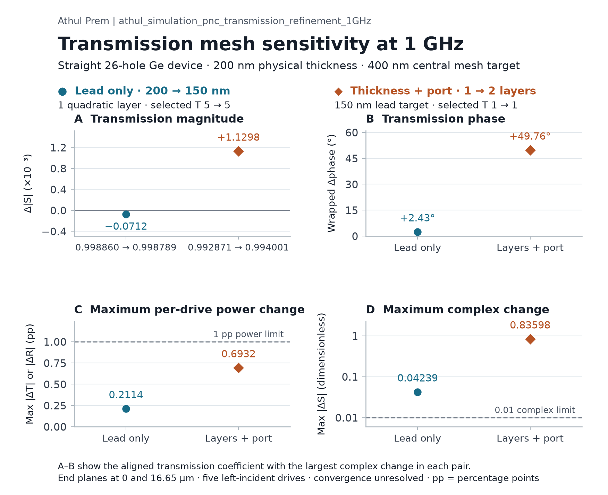

# Straight 26-hole device figures

Author: **Athul Prem** | Project/file tag: **`_AP_pnc`**

These figures answer [Athul's original PR #55 request](https://github.com/premathul/Phononic-Nanobeam-Design-Lab/pull/55#issuecomment-6997331040) and [his reciprocity and complex-ratio follow-up](https://github.com/premathul/Phononic-Nanobeam-Design-Lab/pull/55#issuecomment-7021915522) using saved finite-element results. Both scattering figures use a 200 nm thick nominal germanium device with fixed cubic elastic constants, crystal axes aligned with the laboratory axes, and the original end planes. No new solve is used. Each CSV retains more precision than the plotted labels.

**Reciprocal powers agree to 3.251 × 10⁻⁹ relative on each tested mesh, while their shared magnitude and a rescaling-invariant complex ratio change nonmonotonically.** Reciprocity is a consistency check; it does not establish spatial convergence. The figure separates the two observations and retains the original failed mesh-sensitivity criteria.


| Figure | Plotted data | Script and primary inputs |
| --- | --- | --- |
| [1 · Device geometry (PDF)](device_AP_pnc/athul_simulation_pnc_device_schematic_AP_pnc.pdf) | [Hole positions and diameters (CSV)](device_AP_pnc/device_geometry_AP_pnc.csv) | [Schematic script](../tools/plot_device_schematic_AP_pnc.py), [hole table](../data/geometry/hole_geometry_derived_AP_pnc.csv), [saved device geometry](../data/saved_device_AP_pnc/h80_z6_1/summary_AP_pnc.json), [regional configuration](../configs/historical_26hole_regional_AP_pnc.json) |
| [2 · 1 GHz transmission sensitivity (PDF)](device_AP_pnc/athul_simulation_pnc_transmission_refinement_1GHz_AP_pnc.pdf) | [Complex response comparisons (CSV)](device_AP_pnc/transmission_refinement_1GHz_AP_pnc.csv) | [Transmission script](../tools/plot_transmission_refinement_AP_pnc.py), [lead-only control](../verification/regional_lead_1GHz_AP_pnc.json), [thickness-layer control](../verification/regional_thickness_1GHz_AP_pnc.json) |
| [3 · 887.5 MHz reciprocity and mesh sensitivity (PDF)](device_AP_pnc/athul_simulation_pnc_weak_conversion_8875_AP_pnc.pdf) | [Directed powers and comparison denominators (CSV)](device_AP_pnc/weak_conversion_8875_AP_pnc.csv), [raw complex blocks and diagnostics (CSV)](device_AP_pnc/weak_conversion_diagnostics_8875_AP_pnc.csv) | [Conversion plot](../tools/plot_weak_conversion_AP_pnc.py), [complex-block calculation](../tools/weak_conversion_diagnostics_AP_pnc.py), [in-plane control](../data/saved_device_AP_pnc/controls/frequency_inplane_8875_AP_pnc.json), [thickness-layer control](../data/saved_device_AP_pnc/controls/frequency_thickness_8875_AP_pnc.json) |

Run the following command from the repository root with the [pinned Python environment](../requirements_3d_AP_pnc.txt). It writes all three vector PDFs, PNG previews and four CSVs under `figures/device_AP_pnc/`. Use `--output-dir PATH` for a separate copy. The generator reads repository inputs and runs locally without the simulation archive. Plotting needs Matplotlib; the diagnostic calculation itself uses only Python's standard library. The portable control hashes are checked against the existing [dataset manifest](../configs/saved_device_dataset_AP_pnc.json).

```powershell
.\.venv\Scripts\python.exe tools/plot_saved_device_figures_AP_pnc.py
```

The native coefficient files and their original SHA-256 hashes remain identified in the CSVs. They are archival provenance; reproducing these panels needs only the tracked portable controls. The plots do not load field arrays, rebuild meshes or invoke the solver.

### Reading the figures

**Device geometry.** Both port planes are at the physical ends of the beam, 16.65 µm apart. The outer rims of the first and last through-holes bound the 13.65 µm patterned span, leaving a 1.50 µm unperforated lead at each end. The regional mesher cuts at 1.00 and 15.65 µm so both cuts lie in solid material. The archived meshes in Fig. 3 use global in-plane targets.

**1 GHz transmission.** Each comparison shows the matched incident/outgoing pair with the largest change in a complex scattering coefficient. The lead target changed from 200 to 150 nm at fixed central resolution. The limiting pair was 5→5, with a transmission magnitude decrease of 0.00007124 and a wrapped phase increase of 2.432°. Increasing from one to two quadratic layers through the same 200 nm physical thickness changed the matched 1→1 magnitude by +0.001130 and phase by +49.764°. With phase alignment at the original planes, both maximum complex increments (0.04239 and 0.83598) exceed the 0.01 threshold. Both maximum absolute changes in total per-drive power pass 0.01. For example, the lead refinement raised drive 1 reflection from 1.1893% to 1.4007%, or +0.2114 percentage points and +17.77% relative.

**887.5 MHz reflected conversion.** Each direction is a separate fraction of unit incident power. At the precision shown here, both directions give 1.6552 × 10⁻⁶ at 100 nm/four layers, 9.9165 × 10⁻⁸ at 80 nm/four layers, and 7.9691 × 10⁻⁷ at 80 nm/six layers. The two comparisons share the middle mesh. Relative to the finer result for each comparison, the increments are 1569.1% (in-plane) and 87.56% (through-thickness), both above 10%. Each mesh does satisfy the separate suppression threshold against its own 1 GHz value, a power ratio at most 0.01.

The reciprocal mismatch is defined as `|P(1→5) − P(5→1)| / mean(P)`, without a denominator floor. Its plotted values are observations, not a new acceptance threshold. The mode numbers are the matched 887.5 MHz orders, and the CSV records each mesh's actual native roots. The h100/z4 and h80/z4 pair uses an identical saved port basis. The h80/z4 to h80/z6 pair uses the documented signed mode matches. These are two different refinement controls, not three equally spaced points in a one-parameter convergence sequence.

| Mesh (h in nm; z = quadratic layers) | Mean reciprocal power fraction | Relative reciprocal mismatch | Invariant magnitude \|χ\| | Principal phase arg χ (°) |
| --- | ---: | ---: | ---: | ---: |
| h100 / z4 | 1.6551626350 × 10⁻⁶ | 9.9075935 × 10⁻¹⁰ | 0.00417260898 | −170.92409 |
| h80 / z4 | 9.9164965125 × 10⁻⁸ | 3.2509435 × 10⁻⁹ | 0.000312407121 | +104.92777 |
| h80 / z6 | 7.9691076549 × 10⁻⁷ | 2.9722864 × 10⁻⁹ | 0.00274975378 | +159.34737 |

For the matched two-mode reflection block, let `R_ij` have outgoing mode `i` as its row and incident mode `j` as its column. The local block indices 1 and 2 correspond to the matched full-section modes 1 and 5. Compute the **complex** quotient first:

$$
\chi=\frac{R_{12}R_{21}}{R_{11}R_{22}},\qquad
R'_{ij}=a_iR_{ij}b_j
\quad\Longrightarrow\quad
\chi'=\frac{a_1a_2b_1b_2}{a_1a_2b_1b_2}\chi=\chi.
$$

All row and column factors must be nonzero, and the two diagonal coefficients in the denominator must be nonzero. The saved blocks satisfy these conditions. The diagnostic exports all four native complex entries, both components of χ, its magnitude and its principal phase; no rephasing or reference-plane shift is applied. The marked changes in \|χ\| rule out independent port rescaling or rephasing as the sole relation between these matched blocks. They do **not** rule out mode mixing, identify the error's spatial origin, prove full-matrix reciprocity or support an extrapolated conversion magnitude. The code tests invariance with unequal non-unit complex row and column factors.

### Companion figures





### Evidence needed for a publication claim or frequency sweep

On the tested meshes, the power budgets close, phase is sensitive to discretization, and suppression relative to 1 GHz persists. A quantitative claim for the weak conversion, absolute phase or a spectral minimum needs the following evidence.

1. **Resolve the observable in space.** Keep the geometry, physical end planes and mode matching fixed. Demonstrate a stable trend on at least three systematic meshes for the claimed quantity, with separate controls for in-plane resolution, thickness/port resolution and hole-wall faceting. Retain the original equation and flux checks. For weak conversion, both directed powers must meet the 10% finite-change target with the declared nonzero denominators. For complex transmission, retain the 0.01 complex-coefficient gate and demonstrate that the matched uniform guide reproduces its through-phase at the relevant resolution. A finite-change tolerance by itself supplies no uncertainty bound.
2. **Qualify a short frequency interval first.** Once the selected observable passes at representative points, track modes by signed power and field overlap, account for channels opening or closing, and halve the frequency step around candidate features. Check that amplitudes, phases or extrema used in the claim stay within the declared tolerance. The existing three frequencies do not establish a linewidth, gap or attenuation floor. Expand the sweep only over intervals that pass.
3. **Scope the physical claim.** Compare the inferred effect with the observed numerical uncertainty. A claim about an actual cryogenic device also needs measured dimensions, material properties and an experimental benchmark under the same conditions. The [physics specification](../docs/PHYSICS_SPECIFICATION_AP_pnc.md) gives the model and acceptance criteria.

## Historical figures

`archive_latest/` and `archive_smoke/` group the uploaded figures by lineage/run. Historical pixels and PDF contents are preserved exactly; file suffixes and the provenance index carry project attribution. These figures do not establish a new 3D or temperature-dependent result. Every newly exported figure must show `Athul Prem | athul_simulation_pnc_<identifier>` at the top and use `athul_simulation_pnc_<identifier>_AP_pnc.<extension>`. Record data/configuration/source provenance. See [authorship and naming](../docs/AUTHORSHIP_AND_NAMING_AP_pnc.md).
