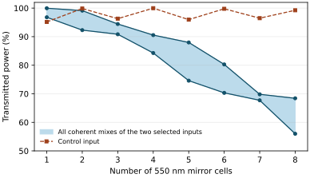

# Mode-selective finite mirror response at 1 GHz

Athul Prem | _AP_pnc | 25 November 2026



**Result.** For the lossless, nominal-Ge, 100 nm periodic mirror at 1 GHz, the computed transmitted-power interval for normalized coherent launches in the two selected incident modes moves from **96.79–99.96%** at one cell to **55.99–68.42%** at eight cells. Comparing the **same** incident vector in one common native port basis gives a **31.44–40.89 percentage-point** reduction. For each additional cell, the restricted power-difference matrix is positive definite on this numerical model; the smallest adjacent eigenvalue is 0.00379 percentage points (1→2), so this fine step is especially sensitive to untested discretization. The separate control input stays between **95.16% and 99.98%**. Intermediate lengths 2–7 are new calculations.

**Model and controls.** One identical discrete cell was joined across each of 1–8 periods with common P2 interface displacement, reaction balance, and full outgoing native SAFE end maps (including evanescent columns). The model has a 550 nm period, 250 nm circular hole, 1 µm width, 100 nm thickness, fixed-property cubic Ge, 32 rim facets, 225 nm central edge target, and two quadratic through-thickness layers. The cross-platform Mac rebuild uses the same geometry and mesh settings as the archived Windows comparison but has a different realized mesh and port digest; its spectra are not treated as byte-identical. All eight new solves use the same rebuilt mesh, condensed blocks, and native port basis, not a change of mesh with length.

**Analysis.** We select the two lowest-transmitting individual inputs at eight cells (native roots 492 and 476 in this run); the selection is diagnostic, not an independent prediction. Hold their span fixed for all lengths. The control is the lowest one-cell transmission among the other inputs (local root 502). Include all five outgoing propagating modes. For input vector x in that span, let G_N = T_N† T_N restricted to the two input columns. The eigenvalues of G_N bound transmission of any unit-norm x; the eigenvalues of G_N − G_M bound the decrease for that *same* x. These are different calculations from subtracting the endpoints of two independently optimized ranges. Incident mode powers are unity to machine precision. Maximum native-equation residual is below 3.54e-13, reported power error below 4.0e-13, and independently recomputed restricted closure below 3.52e-12.

**Scope.** The missing transmitted power is reflected in this lossless model. This is a numerical result about mode-selective finite-length scattering at one frequency. It is not a complete bandgap, a temperature dependence, an exponential decay constant, a converged interval, a tapered-device result, or measured attenuation. The archived Windows 1- and 8-cell comparisons are a separate endpoint cross-check; no cross-platform matching of the control-root label is assumed.

**Reproduce.** Source solver baseline: `8b319eca0fee5d36d5021001d36bba8e425c0854`. Use the environment versions recorded in [the sweep data](length_sweep_AP_pnc.json). From repo root, on the recorded build:

```sh
python tools/run_mirror_length_sweep_AP_pnc.py . /tmp/mirror-length-replay reports/mirror_length_AP_pnc
python tools/plot_mirror_length_sweep_AP_pnc.py /tmp/mirror-length-replay/length_sweep_AP_pnc.json /tmp/mirror-length-replay.svg
```

The driver checks the SHA-256 of the cell archive and the recreated mesh/connectivity digest, then writes new receipts and refuses to overwrite existing result files. If another platform rebuilds a different mesh, recreate a new cell with the recorded settings and report that comparison as a new mesh realization. The exact computed numbers and evidence are available in the eight `finite_*_local_AP_pnc.json` records, the cell receipt, the condensed trace archive, and the summary JSON.
