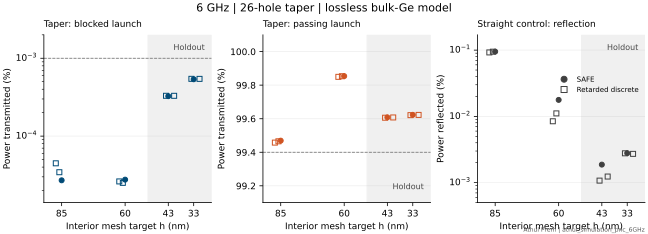

# Launch-selective power transmission at 6 GHz

Athul Prem | _AP_pnc

At 6 GHz the modeled 26-hole taper transmits **more than 99.4%** of incident mechanical power for one specified coherent launch and **less than 0.001%** for another. Both launches transmit more than 99.97% in the matched straight controls. The two finest meshes and both radiation treatments recover this distinction. It is evidence of launch-selective scattering, not a complete stop band. These bounds describe the simulations below, not an arbitrary geometry or drive.



**Figure.** Unit-power, left-incident elastic waves. Open squares are displaced horizontally for visibility only. The straight-control axis is the maximum reflected power over all coherent incident states, not just the two selected launches. H85/H60 selected the launches; shaded H43/H33 are independent spatial-mesh holdouts. Dashed lines mark the reporting bounds. [Vector PDF](two_launches_AP_pnc.pdf) · [PNG](two_launches_AP_pnc.png) · [CSV](fixed_launch_AP_pnc.csv).

## Model and checks

- Nominal 16.65 μm × 1 μm × 100 nm rectangular solid with 26 through-holes from `data/geometry/hole_geometry_derived_AP_pnc.csv`; the blank omits only the holes. Free exterior surfaces, with no explicit damping, actuator, substrate, strain, or optical readout. Cubic elasticity axes are aligned to the computational beam axes. Provisional low-temperature bulk-Ge inputs are C11=131.5 GPa, C12=49.4 GPa, C44=68.4 GPa, and density 5343 kg/m³. This model does **not** establish a measurement or a device-calibrated prediction at 4 K.
- Second-order tetrahedra, condensed across conforming section planes. H85/H60 use 16 × 2 transverse divisions and 32 hole facets; H43/H33 use 20 × 3 and 40 facets. H33 splits solid end sections without changing any hole. The two formulations use semi-analytical finite-element (SAFE) modal leads and retarded discrete half-space matching. The discrete axial lead steps are 43.36 and 21.68 nm on fitted cases, 21.68 and 10.84 nm on holdouts.
- For the power-normalized transmission matrix `t_h`, the launches are the minimum and maximum eigenvectors of `t_85† t_85 + t_60† t_60`. Each frozen displacement trace is projected onto the target modes by weighted cross-sectional least squares and renormalized to unit power; the largest relative trace residual is below 0.48%. Neither holdout was used to refit a launch.
- On the holdouts, the blocked launch transmits at most 5.45 × 10⁻⁶ of unit incident power and the passing launch transmits more than 99.60%. Exact blocked-launch leakage changes with refinement. The broader low-transmission subspace, the full scattering matrix, and transmission phases are not settled. A small straight-control reflection does not imply phase convergence.
- A separate all-solid control reproduces the numerical failure without holes. Coarsening only the center to a 173.44 nm grid yields 98.6% artificial reflection. Its corresponding periodic mesh supports one fewer propagating channel than the exterior fine grid. The uniform matched control has numerical-zero reflection. Unlike that artifact, the two-launch contrast survives the corrected straight reference and both radiation formulations.

## Replay

Regenerate the supplied figure and CSV directly with `python reports/tapered_6GHz_fixed_launch_AP_pnc/render_AP_pnc.py`. The JSON receipt records the flux fractions and digests of the raw FEM artifacts. Raw digests are not expected to match between different solver builds; compare the numerical bounds.

Run the complete replay below from the repository root on a Linux CPU machine, using Python 3.12 and Gmsh's system OpenGL dependency. It writes intermediate FEM data beside the scripts. It is not required for regenerating the plot.

```bash
python -m pip install numpy==2.3.5 scipy==1.17.0 scikit-fem==12.0.2 gmsh==4.15.2 meshio==5.3.5 matplotlib==3.10.8
export PYTHONPATH="$PWD/src" OPENBLAS_NUM_THREADS=2
R=reports/tapered_6GHz_fixed_launch_AP_pnc
python "$R/sectional_taper_AP_pnc.py" 85,16,2,32 60,16,2,32 43,20,3,40 33,20,3,40
python "$R/sectional_matched_AP_pnc.py" 16,2,384 16,2,768 20,3,768 20,3,1536
python "$R/fixed_launch_receipt_AP_pnc.py" > "$R/fixed_launch_replay_AP_pnc.json"
python "$R/blank_dispersion_AP_pnc.py" 96,16,2 384,16,2
python "$R/discrete_blank_AP_pnc.py"
python "$R/discrete_surface_AP_pnc.py"
```

**Experimental validation remains open.** Confirm the fabricated stack and crystal orientation, identify the launch and receive profiles, and measure paired straight/taper samples under the same calibrated drive at 4 K. This result does not predict generic RF S21 or demonstrate phonon pumping.
Source and geometry checked against repository revision `617698deb0ba11a79e9f92a1db50c56c7b4919c4`; see `source_manifest_AP_pnc.sha256`.
