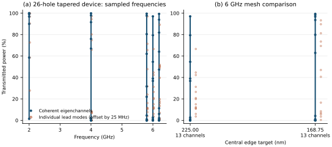
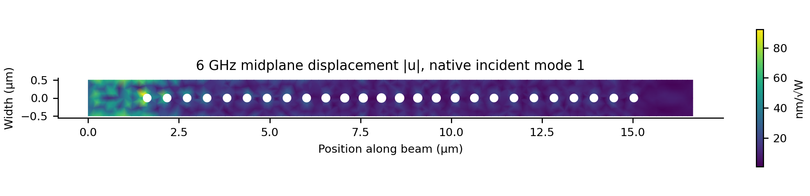

# Tapered Ge nanobeam: 2–6.2 GHz sampled 3D scattering

Athul Prem | _AP_pnc | 26 November 2026

**New calculations.** The full, 26-hole tapered device was solved at **2, 4, 5.8, 6 and 6.2 GHz** on one fixed 225 nm central target mesh. At 6 GHz, the available accepted interior refinements are shown separately. Nominal, lossless cubic Ge; physical thickness 100 nm, width 1 µm, length 16.65 µm; P2 displacement, two through-thickness layers, 32 hole facets, original matched end planes. The recorded temperature is a fixed-property control, not a validated material model for a measured sample.

| GHz | Central target (nm) | Native incident channels | Individual transmission (%) | Coherent eigenchannel range (%) |
|---|---:|---:|---:|---:|
| 2 | 225 | 7 | 27.803–99.890 | 1.421–99.985 |
| 4 | 225 | 11 | 0.011–96.983 | 4.15e-08–99.811 |
| 5.8 | 225 | 13 | 0.215–96.917 | 1.79e-21–99.514 |
| 6 | 225 | 13 | 3.599–66.582 | 1.02e-15–96.975 |
| 6 | 168.75 | 13 | 0.396–93.290 | 5.32e-16–99.323 |
| 6.2 | 225 | 13 | 0.657–89.217 | 6.95e-10–99.305 |

All points shown pass their original equation residuals, single-column and physical-flux power checks, and full left-input coherent power check on their native port. Across the included points, max original equation residual is 9.81e-16, max flux power imbalance 1.83e-13, and max spectral norm of T†T + R†R − I is 1.56e-11. In panel (a), no lines connect frequencies: neither native roots nor transmission-optimal input vectors are tracked across the points. Values close to numerical zero are not measurements, dynamic-range claims or proof of perfect extinction. At 126.5625 nm the direct solve did not return an accepted point under the cloud bound. No results from that attempt are plotted.

**Critical limitation at 6 GHz.** The full-device lead discretization uses 135 transverse DOFs and admits **13** propagating modes at 5.8, 6 and 6.2 GHz. Independent uniform-lead solves with **255 and 357 DOFs** both admit **14** at each of those frequencies. A missing lead channel is a concrete reason not to present these data as a complete, publication-ready 6 GHz scattering result, even where linear equations and power balance are excellent. The body refinements shown retain the same lead model and do not fix this. The broad spreads across input states are not a gap for every incident mode. There is no converged frequency band or experiment claim.

The field panel shows the finite-element nodal magnitude of the first native incident mode on the 225 nm mesh at 6 GHz, in nm/√W of incident power. Rendering interpolates those sampled vertex magnitudes inside the solid midplane triangles; white holes are material voids. This is a displacement map, not a transmission or strain map.

## Reproduce the figures and calculations

- [Native reflected/transmitted coefficients (CSV, gzip)](native_coefficients_AP_pnc.csv.gz), [numerical summary](summary_AP_pnc.json), [6 GHz same-launch check](fixed_6GHz_launch_AP_pnc.json), [independent uniform-lead check](refined_lead_6GHz_AP_pnc.json) and [compact midplane data](midplane_vertices_AP_pnc.npz).
- From the figure folder, run `python render_from_data_AP_pnc.py .` to render directly from the compact data (NumPy and Matplotlib).
- To recompute, run `bash <report-dir>/reproduce_AP_pnc.sh <report-dir> <new-output-dir>` from source revision `240c6805ead982890b84e76b4dd6aa2c21f5674e`. Reuse the released geometry and dependencies; record local NumPy/SciPy/library versions, and run sequentially with one native point per invocation. Independent solver artifacts may differ bytewise across platforms. Only physical/numerical comparisons within a matched realization are reported here.
- [Separate 1 GHz periodic mirror study](../mirror_mode_exchange_AP_pnc/README.md) and [prior closely spaced 1 GHz tapered-device samples](../../verification/thin_mesh_frequency_AP_pnc.json). They are not part of the same frequency sweep.
